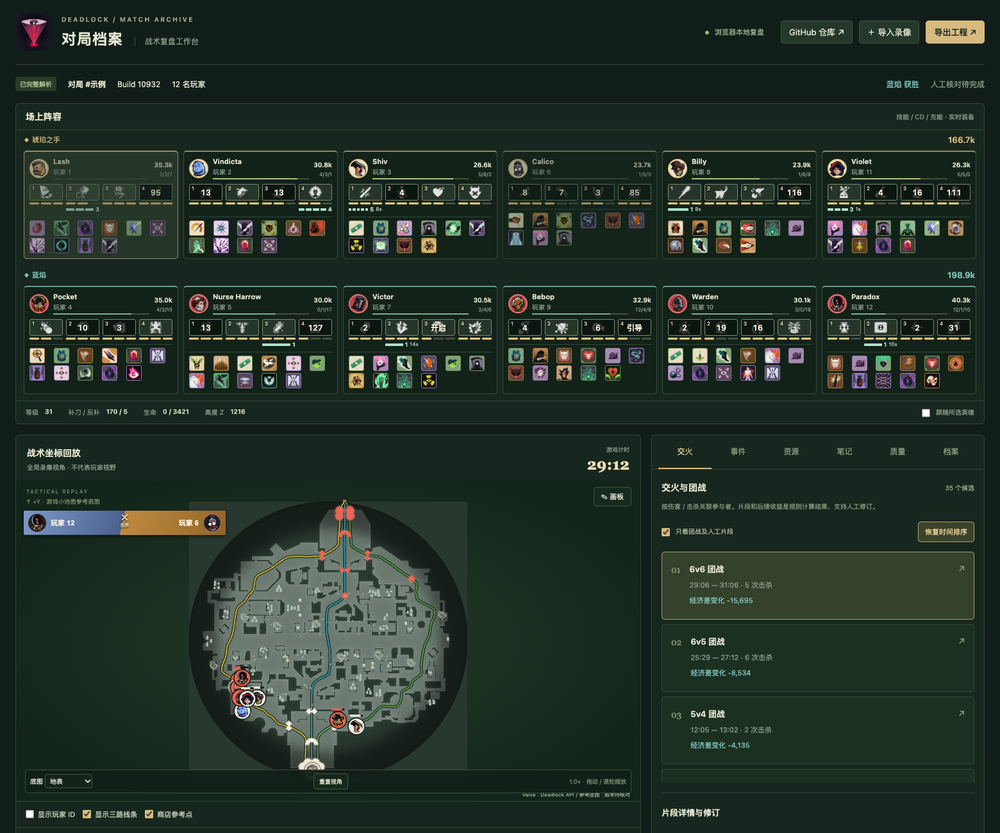

# Focus Lens · Deadlock 复盘工具

聚焦你的队友。导入一场 Deadlock 录像，在战术地图上回看走位、团战和经济变化。录像在浏览器本地解析，无需安装软件。

**[打开 Focus Lens 网页版][web]** · 电脑端 Chrome / Edge

*截图使用匿名工程，玩家昵称已替换。*

## 使用方法

1. 在 Deadlock 的对局历史里下载录像，找到本地 `.dem` 文件。已有 Focus Lens 桌面版导出的 `.dlreview` 工程也可以直接打开。
2. 打开[网页版][web]，点击「导入 .dem / .dlreview」，选择文件并等待解析。
3. 拖动时间轴、点击关键事件，或从「交火与团战」选择片段，跳到想复盘的时刻。

## 可以看什么

- **走位与资源**：缩放战术地图，观察双方移动路线和地图资源，也可以用画板标记站位。
- **团战与经济**：查看参战玩家的伤害、承伤和治疗，按经济差变化排序，优先复盘影响大的片段。
- **阵容与状态**：查看双方英雄、装备，以及录像中可读到的技能等级、冷却和充能。

在「笔记」中添加书签，点击右上角「导出工程」即可保存对局和笔记。下次可导入 `.dlreview` 继续复盘；分享时可在「质量」标签页选择「匿名工程」。

## 反馈与许可

欢迎在 [GitHub Issues][issues] 反馈，或加入 QQ 群 **1062198581** 交流。作者：**Skn1Siyu**。

项目代码采用 [MIT 许可](LICENSE)，第三方组件和游戏素材见[第三方说明](THIRD_PARTY_NOTICES.md)。

[web]: https://skn1siyu.github.io/foucus-lens/
[issues]: https://github.com/Skn1Siyu/foucus-lens/issues
